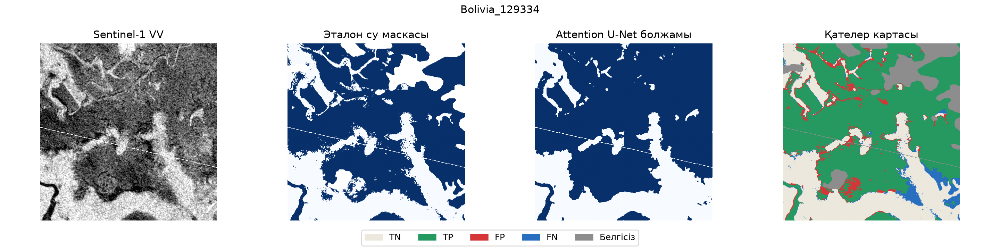
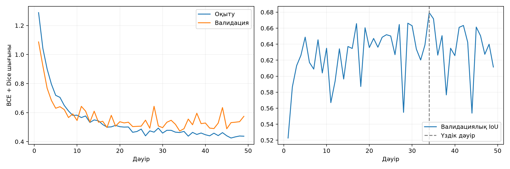

# Sentinel-1 радар суреттерінен су басқан аумақтарды сегментациялау

Бұл репозиторийде «Терең оқыту» (TO 4304) пәні бойынша курстық жұмыстың коды, оқытылған моделі және тәжірибе нәтижелері жинақталған.

**Тақырып:** «Терең оқыту негізінде спутниктік суреттерден су басқан аумақтарды анықтау және сегментациялау»
**Автор:** Серикпаева Аружан, ЖИТ-31 тобы, Л.Н. Гумилев атындағы Еуразия ұлттық университеті



*Сол жақтан оңға қарай: Sentinel-1 радар суреті, сарапшы белгілеген су, модель тапқан су, қателер картасы. Жасыл — дұрыс табылған су, қызыл — суды артық белгілеу, көк — өткізіп алынған су.*

## Жоба не істейді

Тасқын кезінде бұлт жиі болады, сондықтан оптикалық спутник суреттері жер бетін көрсете алмайды. Sentinel-1 радары бұлттың арғы жағын да көреді. Модель радар суретін алып, әр пиксельдің су немесе құрлық екенін анықтайды. Нәтижесінде су басқан аумақтың картасы шығады.

| | |
|---|---|
| **Кіріс** | Sentinel-1 суреті: VV және VH екі арнасы, 512×512 пиксель, бір пиксель шамамен 10 м |
| **Шығыс** | Су маскасы: 0 — құрлық, 1 — су |
| **Деректер** | [Sen1Floods11](https://github.com/cloudtostreet/Sen1Floods11): 11 елдегі тасқыннан алынған 446 қолмен белгіленген сурет |
| **Үздік модель** | Attention U-Net, энкодері ImageNet-те алдын ала оқытылған ResNet-34 |

## Нәтижелер

Бес әдіс бірдей деректерде салыстырылды. Негізгі метрика — **IoU** (модель тапқан су мен нақты судың қабысу үлесі, 100% — мінсіз). Боливия суреттері оқытуға мүлде қатыспаған, сондықтан ол модельдің жаңа аймақта қалай жұмыс істейтінін көрсетеді.

| Әдіс | Тест IoU, % | Тест F1, % | Боливия IoU, % |
|---|---|---|---|
| Otsu шектік әдісі (базалық) | 23,14 | 37,58 | 40,44 |
| Қарапайым U-Net | 66,82 | 80,11 | 58,95 |
| ResNet-34 U-Net, нөлден оқытылған | 68,22 | 81,11 | 63,54 |
| ResNet-34 U-Net, ImageNet салмақтарымен | 68,46 | 81,28 | 68,52 |
| **Attention U-Net (ResNet-34)** | **68,86** | **81,56** | **69,55** |

Негізгі қорытындылар:
- Нейрондық желілер қарапайым шектік әдістен шамамен **3 есе** жақсы. Олар тек жарықтықты емес, көршілес пиксельдерді де ескереді.
- ImageNet-те алдын ала оқыту жаңа аймақта (Боливия) пайдалы: IoU 63,54%-дан 68,52%-ға өсті.
- Attention U-Net пен ResNet-34 U-Net айырмасы шағын (0,40 пайыздық тармақ). Модельдер бір seed-пен оқытылған, ал валидацияда Attention U-Net-тің IoU мәні төмен болды. Сондықтан назар блоктарының артықшылығы толық дәлелденбеген.



*Attention U-Net оқыту барысы. Үздік модель валидациялық IoU бойынша 34-дәуірде таңдалды.*

## Дайын модельді іске қосу

Оқытылған модель — `FloodSegmentation_Defense/models/attention_unet_resnet34.joblib` (91 МБ). GPU қажет емес, қарапайым компьютерде жұмыс істейді. Python 3.11 ұсынылады.

```bash
cd FloodSegmentation_Defense

# 1. Кітапханаларды орнату
python -m pip install -r requirements.txt

# 2. Демонстрацияға арналған екі суретті ресми көзден жүктеу
python download_demo_data.py

# 3. Суретке болжам жасау
python inference.py --model models/attention_unet_resnet34.joblib --image data/S1Hand/Bolivia_103757_S1Hand.tif --output outputs/prediction.tif
```

Нәтиже `outputs/prediction.tif` файлына жазылады: 0 — құрлық, 1 — су, 255 — дерек жоқ пиксель. Координаттар бастапқы суреттегідей сақталады.

Графиктері бар толық демонстрация: `FloodSegmentation_Defense/FloodSegmentation_KZ.ipynb` ноутбугі. Оны Jupyter-де ашып, барлық ұяшықты орындаңыз. Толығырақ: [`FloodSegmentation_Defense/README_KZ.md`](FloodSegmentation_Defense/README_KZ.md).

## Репозиторий құрылымы

```
flood-segmentation-sentinel1/
├── FloodSegmentation_Defense/   ← дайын модель және демонстрация (осыдан бастаңыз)
│   ├── models/                  оқытылған модель (.joblib)
│   ├── inference.py             модельді жүктеу және болжам жасау
│   ├── FloodSegmentation_KZ.ipynb  қазақ тіліндегі демонстрация ноутбугі
│   ├── outputs/, reports/       графиктер, метрикалар, оқыту тарихы
│   └── data/splits/             ресми train / validation / test / Боливия тізімдері
├── flood/                       негізгі код
│   ├── data.py                  деректерді жүктеу, тексеру, нормализация
│   ├── models.py                U-Net, ResNet-34 U-Net, Attention U-Net
│   ├── train.py                 оқыту циклі және checkpoint-тер
│   ├── evaluate.py              бағалау, шекті таңдау, карталар
│   └── improve.py               қосымша жақсартулар (шекара шығыны, TTA)
├── notebooks/                   Google Colab ноутбуктері (модельдерді оқыту)
├── reports/                     тәжірибе скрипттері, кестелер, Боливия бойынша қателер талдауы
└── tests/                       автоматты тексерулер
```

## Модельдерді қайта оқыту (Google Colab)

Оқыту үшін GPU керек, сондықтан Google Colab қолданылды (Tesla T4, бір модельге шамамен 25–35 минут).

1. `notebooks/FloodSegmentation_Colab.ipynb` ноутбугін Colab-та ашыңыз. Мәзірде **Runtime → Change runtime type → T4 GPU** таңдаңыз.
2. Ұяшықтарды ретімен орындаңыз. Деректер ресми көзден автоматты түрде жүктеледі, нәтижелер Google Drive-тағы `FloodSegmentation` бумасына сақталады. Бұл ноутбук Otsu, қарапайым U-Net және ResNet-34 U-Net модельдерін оқытады.
3. Attention U-Net үшін: `notebooks/Attention_Bolivia_Colab.ipynb`.
4. Сеанс үзілсе, ұяшықты қайта іске қосыңыз: оқыту соңғы сақталған дәуірден жалғасады.

`notebooks/FloodSegmentation_Improve.ipynb` — модельді бірнеше seed-пен қайта оқыту және шекара қателерін азайтуға арналған қосымша ноутбук. Ол **әлі іске қосылмаған**, сондықтан оның нәтижелері жоғарыдағы кестеге кірмейді.

## Әдістеме қысқаша

- **Деректерді бөлу:** Sen1Floods11-тің ресми бөлуі — оқыту 252, валидация 89, тест 90, Боливия 15 сурет.
- **Алдын ала өңдеу:** VV/VH мәндері тек оқыту бөлігінің статистикасымен нормализацияланады. Белгісіз пиксельдер шығын мен метрикаға қатыспайды. 512×512 сурет төрт 256×256 бөлікке бөлінеді. Аугментация: 90°-қа бұру және шағылыстыру.
- **Оқыту:** AdamW, оқу жылдамдығы 0,0001, пакет 8, ең көбі 100 дәуір, валидациялық IoU 15 дәуір өспесе тоқтату, seed 42.
- **Шығын функциясы:** BCE + Dice.
- **Шекті таңдау:** су/құрлық шегі тек валидация бойынша таңдалады; тест тек соңғы бағалауға қолданылады.

## Шектеулер

- Модельдер бір ғана seed-пен оқытылды, сондықтан шағын айырмалар кездейсоқ болуы мүмкін.
- Деректердегі су маскасына тұрақты су (өзен, көл) да кіреді. Жаңадан су басқан жерді бөліп алу үшін тасқынға дейінгі суретпен немесе тұрақты су картасымен салыстыру қажет.
- Деректерде Орталық Азиядан оқиға жоқ. Қазақстанда қолданар алдында модельді жергілікті деректе тексеру керек.

## Тесттер

```bash
python -m pip install -r requirements-colab.txt torch
python -m unittest discover -s tests -v
```

## Деректер және дереккөздер

- Bonafilia D., Tellman B., Anderson T., Issenberg E. *Sen1Floods11: A Georeferenced Dataset to Train and Test Deep Learning Flood Algorithms for Sentinel-1.* CVPR Workshops, 2020.
- Деректер: <https://github.com/cloudtostreet/Sen1Floods11>. Суреттер бұл репозиторийге қосылмаған, код оларды бастапқы көзден жүктейді.

## Жасанды интеллект құралдары

Кодты реттеу мен модельді экспорттауда OpenAI Codex, ал есепті тексеру, әдебиет іздеу және жақсартулар ноутбугін дайындауда Claude (Anthropic) қолданылды. Барлық сандық нәтижелер Google Colab-тағы нақты есептеулерден алынды.
